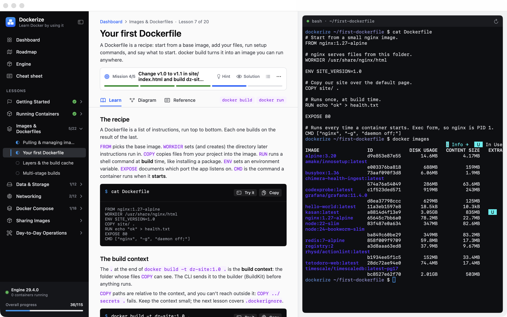

# Dockerize

Learn Docker by using it. Dockerize is a Mac app with a real shell built in: read a short lesson, look at the diagram, then run real containers in the terminal beside it. Dockerize checks your work against the live Docker engine as you go.

**Website:** https://mmerioles.github.io/dockerize/



- 20 lessons and 115 missions across 8 sections: containers, images and Dockerfiles, volumes, networking, Compose, registries, cleanup and debugging
- Missions are checked against the engine itself (is `dz-web` running? does it publish port 8080? is it on `dz-net`?), not just against what you typed
- A diagram, a quick reference and Mac-specific notes for every lesson, plus a searchable cheat sheet of every command
- An **Engine** page that lists your containers, images, volumes and networks live, and types the right command for each action into the shell
- One-click pulls for each lesson's images, and **Docker → Clean Up Lab Resources** to remove everything the lessons created (all named `dz-…`)

## Install

1. Install a Docker runtime if you don't have one: [OrbStack](https://orbstack.dev) (`brew install --cask orbstack`), [Docker Desktop](https://www.docker.com/products/docker-desktop/) or [Colima](https://github.com/abiosoft/colima). Dockerize finds the `docker` CLI and can start OrbStack, Docker Desktop or Rancher Desktop for you.
2. Download `Dockerize.dmg` from the [latest release](https://github.com/mmerioles/dockerize/releases/latest), open it and drag **Dockerize** to **Applications**.
3. On first launch, macOS will block the app because it isn't notarized. Open **System Settings → Privacy & Security** and click **Open Anyway** (on macOS 14, Control-click the app and choose **Open**).

Requires macOS 14 Sonoma or later, on Apple silicon or Intel.

## How it works

- The shell is `/bin/bash` with a sandbox `$HOME` (`~/Library/Application Support/Dockerize/home`) and one workspace folder per lesson, seeded with Dockerfiles, app code and `compose.yaml` files.
- `docker` in that shell uses your real Docker config and context (`DOCKER_CONFIG` points at `~/.docker`), so containers run on your normal engine.
- Every lesson names what it creates `dz-…` and uses a few small pinned images (`alpine:3.20`, `nginx:1.27-alpine`, `redis:7-alpine`, `python:3.12-alpine`, `busybox:1.36`, `registry:2`), so cleanup never touches anything else.

## Develop

```sh
swift run          # build and launch
swift test         # curriculum, state-parsing and shell tests
DOCKERIZE_E2E=1 swift test --filter SolutionTests   # run every mission's solution against a real engine
```

Other tools:

| Command | What it does |
| --- | --- |
| `scripts/build-dmg.sh [version]` | Builds a universal `dist/Dockerize.app` and `dist/Dockerize.dmg` |
| `swift run Dockerize --screenshots docs/assets` | Renders the website screenshots from a throwaway demo workspace |
| `swift run Dockerize --export-diagrams DIR` | Writes every lesson diagram as a PNG |

## Releases and website

- **Website:** `docs/` is deployed to GitHub Pages by `.github/workflows/pages.yml` on every push to `main` that touches it. In the repo settings, set **Pages → Source** to **GitHub Actions**.
- **DMG:** pushing a tag like `v0.1.0` runs `.github/workflows/release.yml`, which builds the DMG and attaches it to a GitHub release.
